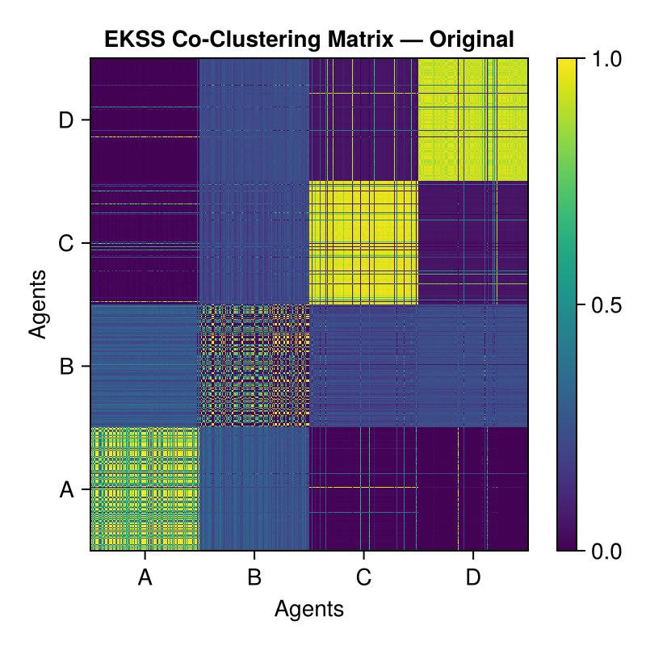
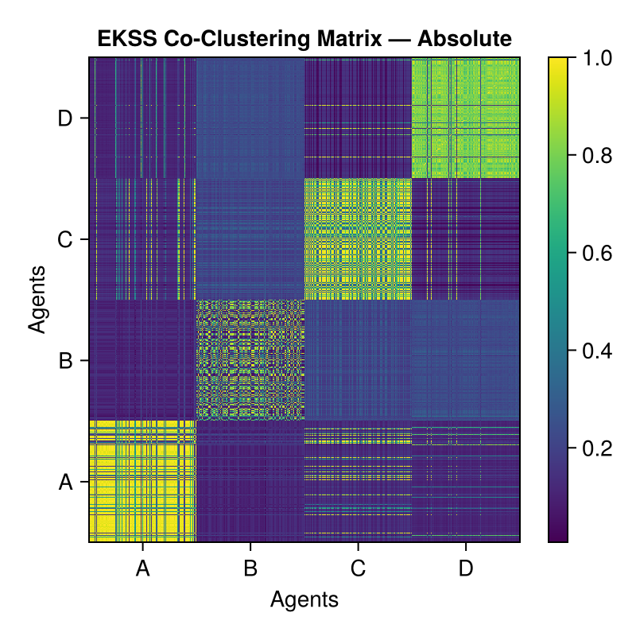
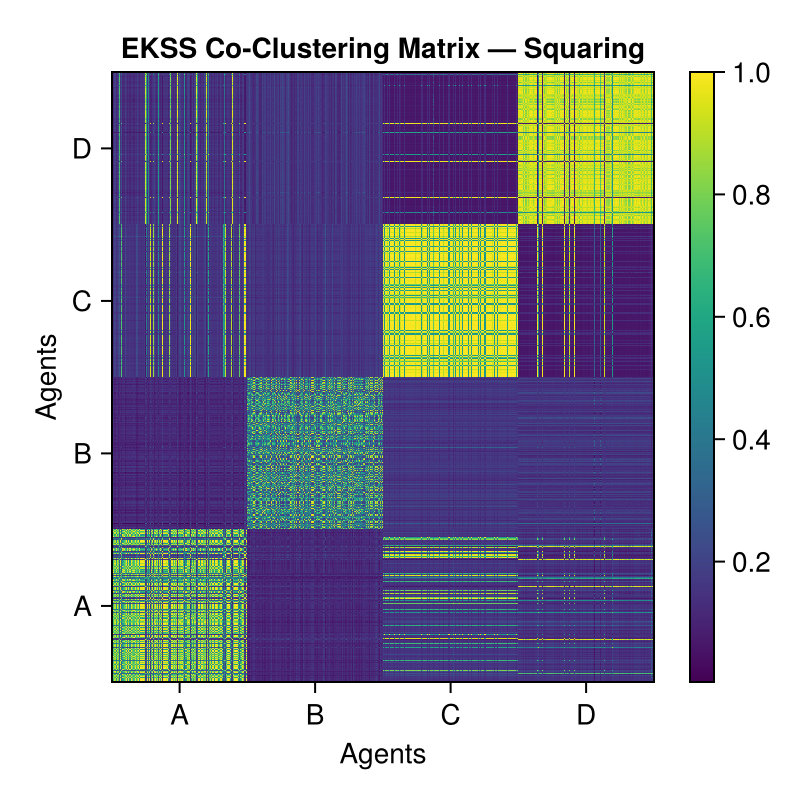

## Unsupervised Learning Techniques to Identify Biological Agents from Mass Spectrometry Data

This repository explores the application of unsupervised learning techniques to identify and classify biological agents from mass spectrometry data. Our dataset consists of mass spectra for two proteins (Protein A and B) and two bacterial agents (Bacteria C and D).

We compare three clustering methods:
- **Spectral Clustering**
- **K-Subspaces (KSS)**
- **Ensemble K-Subspaces (EKSS)**

We also investigate how preprocessing affects clustering by comparing the original data with element-wise absolute-value and squaring transformations.

### Mass Spectra Visualization

Below is an illustration of the mass spectra for the four agents. The figure comprises:

- **Top Panel**: Heatmaps displaying the intensity patterns of the mass spectra for each biological agent.
- **Bottom Panel**: Mean spectral plots highlighting intensity peaks and variations across spectral bands. These patterns provide features for distinguishing the agents.

### Confusion Matrices

The following figures compare the cluster assignments produced by Spectral Clustering, KSS, and EKSS under each preprocessing method.

- **Horizontal Axis**: Biological agents (A–D).
- **Vertical Axis**: Predicted clusters.
- **Cell Values**: Percentage of spectra from each agent assigned to each cluster.

Cluster numbers are arbitrary and may differ between algorithms or runs. Successful separation is indicated when each agent is concentrated in a distinct cluster, regardless of whether the largest values lie on the diagonal.

#### Original Data

Clustering results using the original mass spectrometry data.

#### Element-wise Absolute Value

Clustering results after applying the absolute-value transformation to each data entry.

#### Element-wise Squaring

Clustering results after squaring each data entry.

### EKSS Co-Clustering Matrices

EKSS combines multiple KSS runs by constructing a co-clustering matrix. Each entry represents the fraction of runs in which a pair of spectra was assigned to the same cluster:

- **Values near 1**: The spectra were consistently clustered together.
- **Values near 0**: The spectra were rarely clustered together.

Spectra are ordered by biological agent (A–D) along both axes. Distinct diagonal blocks indicate consistent grouping within agents, while off-diagonal structure indicates grouping across agents.

#### Original Data

#### Element-wise Absolute Value

#### Element-wise Squaring

### Julia Notebook

Explore the implementation, preprocessing options, and clustering visualizations in the exported Julia notebook:

[**View Ensemble KSS Julia Notebook as a webpage**](https://cristy210.github.io/Biomolecular-Identification---Mass-Spectrometry/1_667_ProjSub.html)
